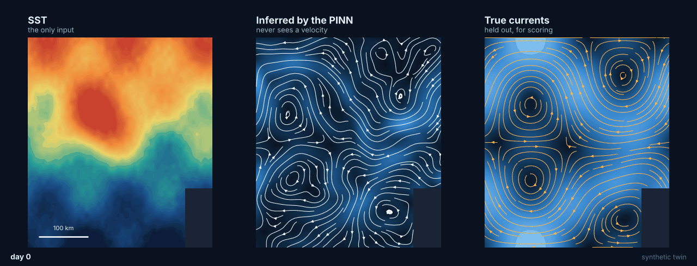
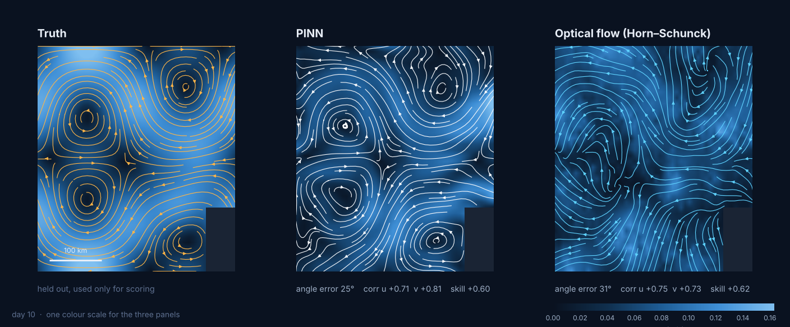
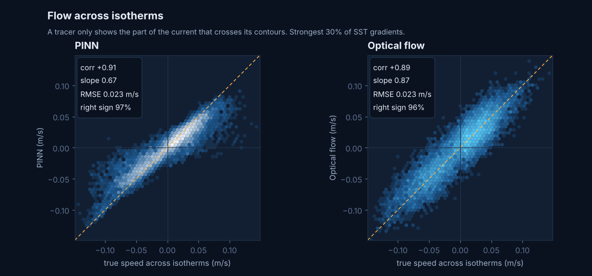
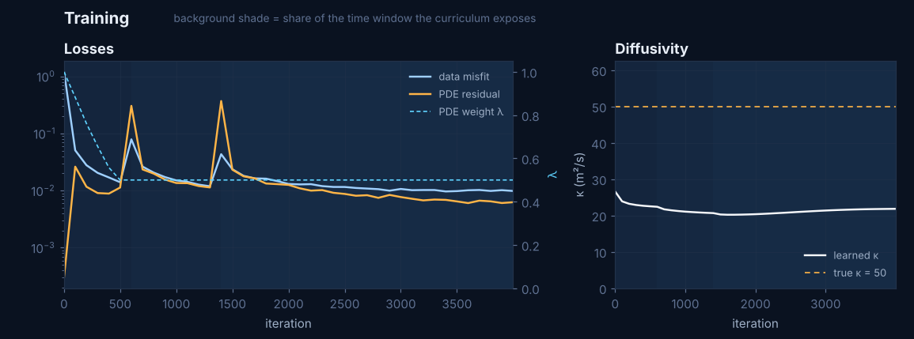

<div align="center">

# hidden-currents

Ocean surface currents recovered from sea surface temperature alone,<br>
with an advection-diffusion physics-informed neural network.

[](https://github.com/abderrazzak-elammari/hidden-currents/actions/workflows/tests.yml)
[](requirements.txt)
[](https://pytorch.org)
[](LICENSE)
[](https://abderrazzak-elammari.github.io/hidden-currents/)

</div>



The network is given daily SST maps and nothing else. It returns the velocity field, a diffusivity and a heat source that together explain how the temperature pattern deforms from one day to the next. The currents are then scored against a measurement the model never sees: HF radar in the south-east Bay of Biscay, or the known field of a synthetic twin.

The [interactive viewer](https://abderrazzak-elammari.github.io/hidden-currents/) plays the 21 days, overlays PINN, reference and optical-flow arrows, and shows the scores and the training curves.

[](https://abderrazzak-elammari.github.io/hidden-currents/)

## Method

The SST is assumed to obey an advection-diffusion equation with a source,

```math
\partial_t T + \mathbf{u}\cdot\nabla T = \kappa\,\Delta T + S,
\qquad
\mathbf{u} = \left(-\partial_y \psi,\; \partial_x \psi\right).
```

Three small MLPs of $(x, y, t)$ represent $T$, the stream function $\psi$ and the source $S$; $\kappa$ is one learned scalar. Writing the velocity as the curl of $\psi$ makes it divergence free by construction: the solution cannot create or remove water. The loss is the misfit to the observed SST plus $\lambda$ times the PDE residual on random collocation points, plus small penalties on $S$ and on $\partial_t \psi$.

Training depends on three details:

- Fourier features with a separate scale per axis: high frequencies in space, low ones in time.
- A time curriculum: the first third of the window, then two thirds, then all of it.
- $\lambda$ balanced against the data term by the ratio of their gradient norms, with a floor $\lambda \ge \lambda_{\min}$. Without the floor, on real SST the balancing walks $\lambda$ down to 0.01 and $\psi$ ends up unconstrained.

The baseline is Horn-Schunck optical flow, which reads the same SST maps with no physics beyond brightness constancy. Its smoothing parameter was swept on the twin and set to the best value ($\alpha$ = 0.3), so the comparison gives it every advantage.

## Results on the synthetic twin

A known velocity field (four gyres, a westward drift, a coastal corner) advects a temperature pattern for 21 days with a semi-Lagrangian scheme, diffusion ($\kappa$ = 50 m²/s), a source term and observation noise. Every method is scored on the same 38,703 sea points (cells × days).

| | PINN, $\lambda_{\min}$ = 0.5 (default) | PINN, $\lambda_{\min}$ = 0 | Horn-Schunck | no current |
|---|:---:|:---:|:---:|:---:|
| angle error | 25° | **17°** | 31° |  |
| correlation u | 0.71 | **0.85** | 0.75 |  |
| correlation v | 0.81 | **0.86** | 0.73 |  |
| vector RMSE (m/s) | 0.063 | **0.047** | 0.061 | 0.099 |
| skill vs no current | +0.60 | **+0.78** | +0.62 | 0 |
| across isotherms, correlation | 0.91 | **0.95** | 0.89 |  |
| across isotherms, right sign | 97% | **99%** | 96% |  |
| learned $\kappa$ (m²/s, true 50) | 22 | 23 | | |

Skill is $1 - \text{MSE}/\text{MSE}_{\text{no current}}$. 4000 iterations, seed 0, CPU. The $\lambda_{\min}$ = 0 column comes out identical to three decimals on Linux and on Windows.



What the table says:

- With its default floor the PINN and the tuned optical flow are close: the PINN points the right way more often (25° against 31°), the optical flow gets the speeds a little better (RMSE 0.061 against 0.063 m/s).
- With no floor on $\lambda$ the PINN is clearly ahead of the baseline. The floor costs accuracy on the twin and is there for the real data, where the residual cannot reach zero.
- $\kappa$ comes out at less than half its true value. The source term absorbs part of the diffusion, since both smooth the field.

A tracer only shows the part of the current that crosses its contours: along an isotherm, motion leaves the map unchanged. On the strongest 30% of SST gradients, the across-isotherm component correlates at 0.89 or more with the truth for all three methods. The slopes tell them apart: at the default setting the PINN underestimates that component (slope 0.67), optical flow much less (0.87).





The two spikes are the curriculum opening the time window. The PDE weight settles on its floor after about 500 iterations.

## Real data

The pipeline runs end to end on two public ERDDAP servers, no account needed:

| | dataset | server |
|---|---|---|
| SST | NASA JPL MUR, 0.01° daily, read at 0.05° | NOAA CoastWatch, `jplMURSST41` |
| HF radar | EUSKOOS totals, hourly since December 2018 | EMODnet Physics, `EUHFR_NRTcurrent_HFR-EUSKOOS-Total` |

Radar days with fewer than 12 valid hours are dropped, and so are cells with GDOP above 2.

Real data has no positive result yet. On October 2020 the PINN scores at chance (88° angle error before the floor on $\lambda$, still at chance after it). `check_signal.py` asks the question without any model: does the observed SST tendency correlate with the advection that the radar currents predict? For that window the answer is 0.02 to 0.10: the information is not in MUR there, so no method reading these maps could recover the currents. The likely reason is that MUR fills clouds by interpolating across days, and October is cloudy. `scan.py` runs the same check over one window per season in 2021 and 2022 to find periods where the signal exists before training on them.

## Quickstart

```bash
git clone https://github.com/abderrazzak-elammari/hidden-currents
cd hidden-currents
python -m venv .venv
source .venv/bin/activate            # Windows: .venv\Scripts\Activate.ps1
pip install -r requirements.txt
```

Synthetic twin, end to end. Training takes 20 to 45 minutes on a laptop CPU:

```bash
python synth.py
python pinn.py --data data/synth.npz --out runs/synth --steps 4000
python evaluate.py --run runs/synth --data data/synth.npz
python figures.py
python -m http.server -d web 8000    # then http://localhost:8000
```

Real data:

```bash
python fetch.py --info                                  # what both servers hold
python fetch.py --start 2020-10-01 --end 2020-10-21
python check_signal.py                                  # is the current visible in the SST at all
python scan.py                                          # same check, one window per season
python pinn.py --data data/sst_2020-10-01_2020-10-21.nc --out runs/oct2020 --steps 12000
python evaluate.py --run runs/oct2020 --data data/sst_2020-10-01_2020-10-21.nc --radar data/radar_2020-10-01_2020-10-21.nc
```

## Repository

```
synth.py          synthetic twin: known currents, advected SST
fetch.py          MUR SST + EUSKOOS radar from ERDDAP, daily radar means, GDOP filter
pinn.py           the three networks, the loss, the curriculum, training
optflow.py        Horn-Schunck baseline
evaluate.py       scores against radar or truth, exports the viewer JSON
check_signal.py   model-free test: does the SST move with the radar currents
scan.py           that test over several seasons
figures.py        the figures in this README, from the viewer JSON
web/              static viewer, also deployed to GitHub Pages
tests/            pytest: twin, training, evaluation, real-data loading on server-shaped files
```

`pytest -q` runs locally and on every push through GitHub Actions.

## Next steps

- Stop the source term from eating the diffusion: regularise $S$ harder, or freeze it for the first half of training.
- Weight the data loss by MUR's `analysis_error`, so cloud-filled pixels count less than observed ones.
- Use L3 SST (single satellite passes) where MUR carries no signal.
- Try chlorophyll as the tracer: a bloom is a reaction term, a harder test.
- Use the radar QC flags on top of GDOP.
- L-BFGS after Adam; sweep the length of the time window.


## References

1. M. Raissi, P. Perdikaris, G. E. Karniadakis. Physics-informed neural networks: a deep learning framework for solving forward and inverse problems involving nonlinear partial differential equations. *Journal of Computational Physics* 378, 686-707, 2019. [doi:10.1016/j.jcp.2018.10.045](https://doi.org/10.1016/j.jcp.2018.10.045)
2. M. Raissi, A. Yazdani, G. E. Karniadakis. Hidden fluid mechanics: learning velocity and pressure fields from flow visualizations. *Science* 367(6481), 1026-1030, 2020. [doi:10.1126/science.aaw4741](https://doi.org/10.1126/science.aaw4741)
3. M. Tancik, P. P. Srinivasan, B. Mildenhall, S. Fridovich-Keil, N. Raghavan, U. Singhal, R. Ramamoorthi, J. T. Barron, R. Ng. Fourier features let networks learn high frequency functions in low dimensional domains. *NeurIPS* 33, 2020. [arXiv:2006.10739](https://arxiv.org/abs/2006.10739)
4. A. S. Krishnapriyan, A. Gholami, S. Zhe, R. M. Kirby, M. W. Mahoney. Characterizing possible failure modes in physics-informed neural networks. *NeurIPS* 34, 2021. [arXiv:2109.01050](https://arxiv.org/abs/2109.01050)
5. S. Wang, Y. Teng, P. Perdikaris. Understanding and mitigating gradient flow pathologies in physics-informed neural networks. *SIAM Journal on Scientific Computing* 43(5), A3055-A3081, 2021. [doi:10.1137/20M1318043](https://doi.org/10.1137/20M1318043)
6. B. K. P. Horn, B. G. Schunck. Determining optical flow. *Artificial Intelligence* 17, 185-203, 1981. [doi:10.1016/0004-3702(81)90024-2](https://doi.org/10.1016/0004-3702(81)90024-2)
7. W. J. Emery, A. C. Thomas, M. J. Collins, W. R. Crawford, D. L. Mackas. An objective method for computing advective surface velocities from sequential infrared satellite images. *Journal of Geophysical Research* 91(C11), 12865-12878, 1986. [doi:10.1029/JC091iC11p12865](https://doi.org/10.1029/JC091iC11p12865)
8. A. Sinha, R. Abernathey. Estimating ocean surface currents with machine learning. *Frontiers in Marine Science* 8, 672477, 2021. [doi:10.3389/fmars.2021.672477](https://doi.org/10.3389/fmars.2021.672477)
9. T. M. Chin, J. Vazquez-Cuervo, E. M. Armstrong. A multi-scale high-resolution analysis of global sea surface temperature. *Remote Sensing of Environment* 200, 154-169, 2017. [doi:10.1016/j.rse.2017.07.029](https://doi.org/10.1016/j.rse.2017.07.029)
10. JPL MUR MEaSUREs Project. GHRSST Level 4 MUR Global Foundation Sea Surface Temperature Analysis, v4.1. NASA PO.DAAC. [doi:10.5067/GHGMR-4FJ04](https://doi.org/10.5067/GHGMR-4FJ04)
11. L. Solabarrieta, A. Rubio, S. Castanedo, R. Medina, G. Charria, C. Hernández. Surface water circulation patterns in the southeastern Bay of Biscay: new evidences from HF radar data. *Continental Shelf Research* 74, 60-76, 2014. [doi:10.1016/j.csr.2013.11.022](https://doi.org/10.1016/j.csr.2013.11.022)
12. A. Rubio, J. Mader, L. Corgnati, C. Mantovani, A. Griffa et al. HF radar activity in European coastal seas: next steps toward a pan-European HF radar network. *Frontiers in Marine Science* 4, 8, 2017. [doi:10.3389/fmars.2017.00008](https://doi.org/10.3389/fmars.2017.00008)

## Citation

See [CITATION.cff](CITATION.cff). MIT licence.

Abderrazzak El Ammari, Laboratoire MIA, La Rochelle Université.
