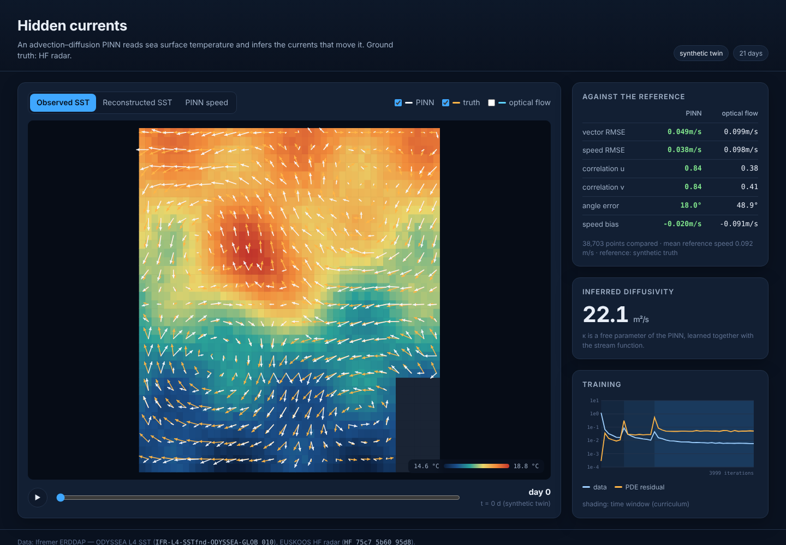

# hidden-currents

## What is it?

A PINN that reads daily sea surface temperature (SST) maps and works out the current that deforms them. It never sees a velocity. It learns a stream function ψ (so the field is divergence free), a diffusivity κ and a small source term, under the constraint

    ∂T/∂t + u·∇T = κ ΔT + S        u = -∂ψ/∂y,  v = ∂ψ/∂x

The inferred currents are checked against HF radars, which actually measure velocity. A Horn–Schunck optical flow is the dumb baseline.

Ifremer data, through ERDDAP, no account needed:

- ODYSSEA L4 SST, 0.1°, daily: `IFR-L4-SSTfnd-ODYSSEA-GLOB_010`
- EUSKOOS HF radar (SE Bay of Biscay), hourly: `HF_75c7_5b60_95d8`

They overlap from December 2018 to June 2021. Default window is October 2020.

A synthetic twin (`synth.py`) runs everything offline and checks that the PINN recovers a known field.

`web/` is a static viewer: SST, PINN arrows against radar arrows, metrics, training curve.

On the synthetic twin (4000 steps, CPU): correlation 0.84 on both u and v, angle error 18°, RMSE 0.049 m/s for a mean speed of 0.09 m/s. Optical flow gets 0.40 / 49° / 0.099 on the same points.

## How to run it

    pip install -r requirements.txt

Synthetic twin, end to end:

    python synth.py
    python pinn.py --data data/synth.npz --out runs/synth --steps 4000
    python evaluate.py --run runs/synth --data data/synth.npz
    python -m http.server -d web 8000

Real data:

    python fetch.py --start 2020-10-01 --end 2020-10-21
    python pinn.py --data data/sst_2020-10-01_2020-10-21.nc --out runs/oct2020 --steps 12000
    python evaluate.py --run runs/oct2020 --data data/sst_2020-10-01_2020-10-21.nc --radar data/radar_2020-10-01_2020-10-21.nc

Then http://localhost:8000.

On CPU, 4000 steps with batch 2048 take ~7 min. On a GPU it is a minute. Use `--batch 4096` as soon as memory allows.

Tests:

    pytest -q

## TODO

- κ comes out at ~22 m²/s for a true 50 in the twin: the source term S eats part of the diffusion. Regularize S harder, or freeze it for the first half of training
- switch to the regional ODYSSEA at 0.02° (same Ifremer product, served by Copernicus as `SST_ATL_SST_L4_NRT_OBSERVATIONS_010_025`); the global 0.1° one is 13 pixels wide over the radar area
- use GDOP and the radar QC flags instead of taking everything
- in summer S absorbs too much (heat flux). Constrain it with a climatology or make it spatially uniform
- L-BFGS at the end of training
- try chlorophyll as the tracer (a bloom is a reaction term, the real test)
- the 3-week window is a guess, sweep it
- GeoJSON export of the currents for QGIS
